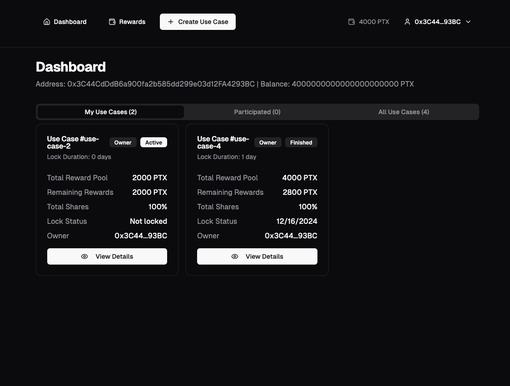
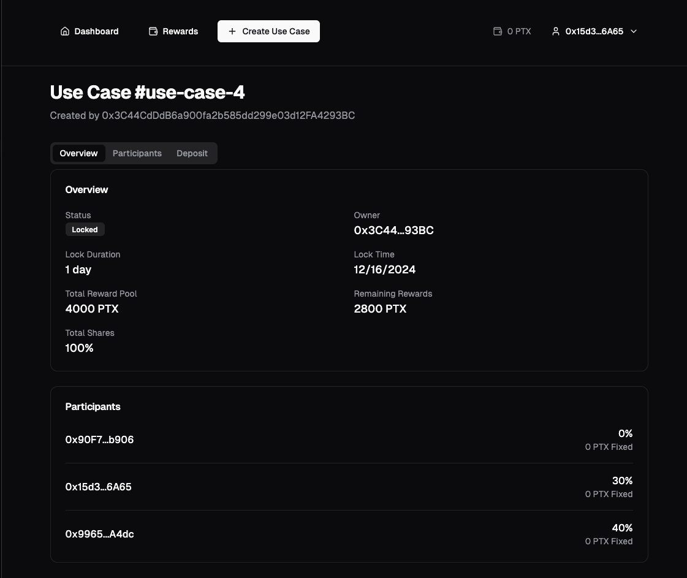
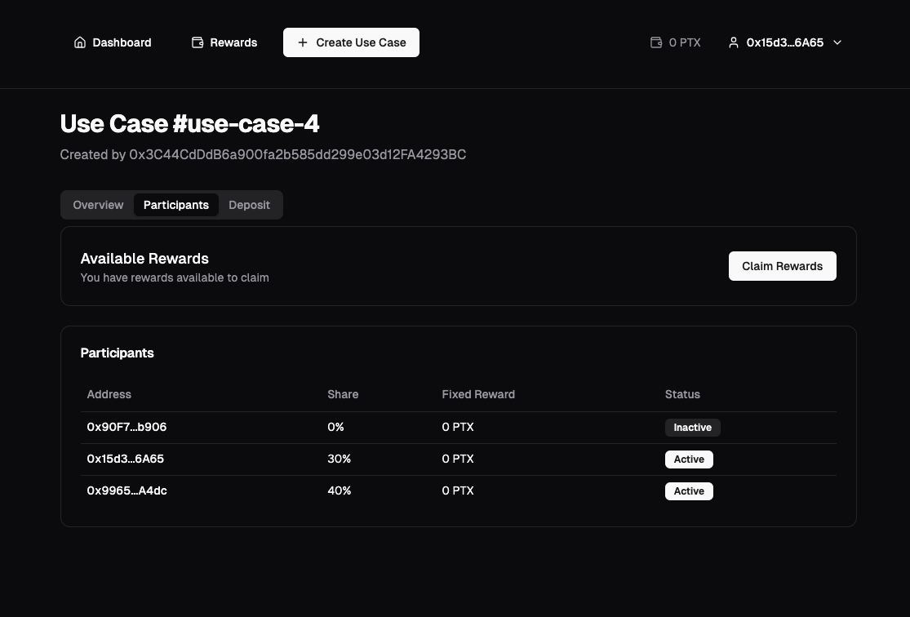
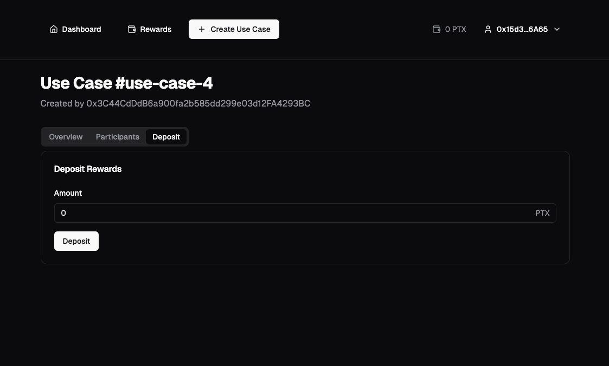
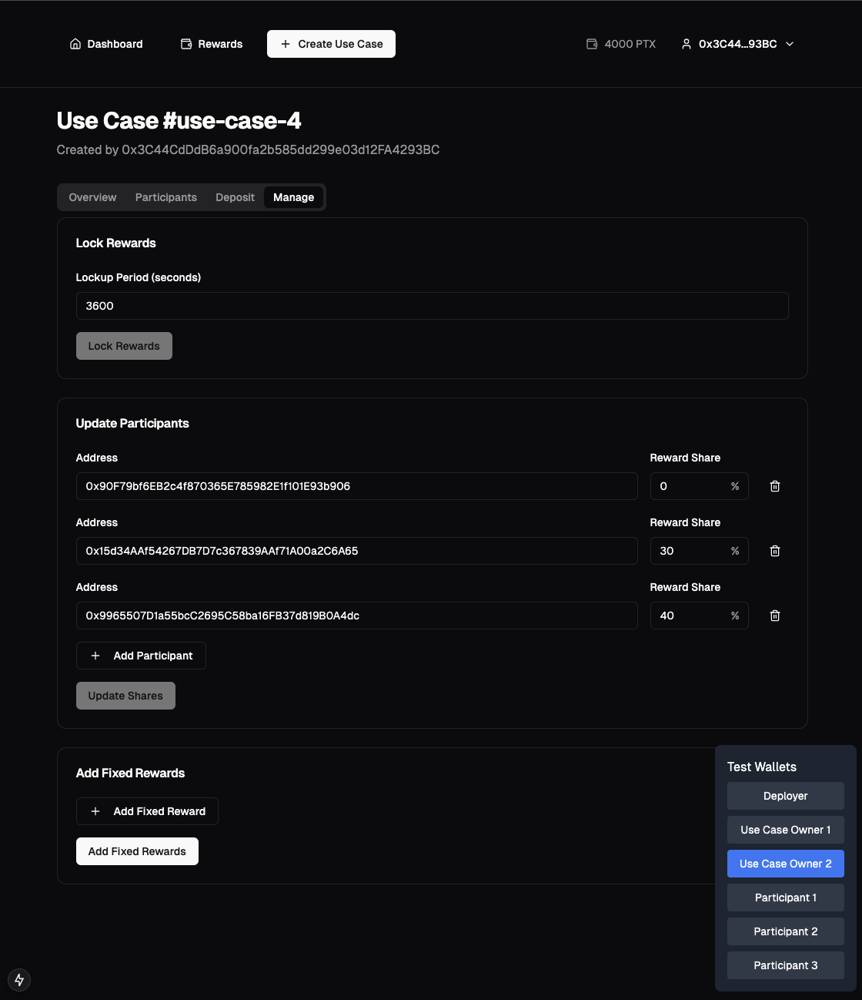
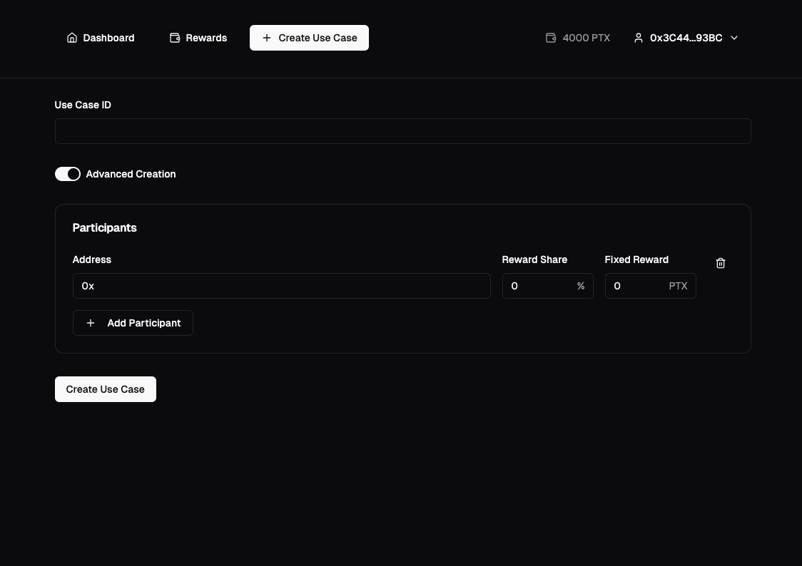

# Data value chain tracker BB

# Documentation

The full documentation is in the **[DVCT Wiki](https://github.com/Prometheus-X-association/data-value-chain-tracker/wiki)**:

- [Overview](https://github.com/Prometheus-X-association/data-value-chain-tracker/wiki/Overview) – concepts and architecture
- [Getting started](https://github.com/Prometheus-X-association/data-value-chain-tracker/wiki/Getting-Started) – installation, development mode, first exchange
- [Configuration](https://github.com/Prometheus-X-association/data-value-chain-tracker/wiki/Configuration) – environment variables and organization registry
- [Data Exchange Integration](https://github.com/Prometheus-X-association/data-value-chain-tracker/wiki/Data-Exchange-Integration) and [Run Script Protocol](https://github.com/Prometheus-X-association/data-value-chain-tracker/wiki/Run-Script-Protocol) – how the PDC calls DVCT
- [Processing Jobs](https://github.com/Prometheus-X-association/data-value-chain-tracker/wiki/Processing-Jobs) – job status, steps, errors and retries
- [Traceability Graph](https://github.com/Prometheus-X-association/data-value-chain-tracker/wiki/Traceability-Graph), [Incentive Distribution](https://github.com/Prometheus-X-association/data-value-chain-tracker/wiki/Incentive-Distribution), [Smart Contracts](https://github.com/Prometheus-X-association/data-value-chain-tracker/wiki/Smart-Contracts)
- [Security Model](https://github.com/Prometheus-X-association/data-value-chain-tracker/wiki/Security-Model), [API Reference](https://github.com/Prometheus-X-association/data-value-chain-tracker/wiki/API-Reference), [Testing](https://github.com/Prometheus-X-association/data-value-chain-tracker/wiki/Testing)

# Design Document

See the design document [here](docs/design-document.md).

# Building instructions
DVCT requires to build&start services like: core-api, core-frontend, hardhat, incentive-api, incentive-frontend, trace-api alongside mongodb

RUN **make init** once to generate the local secrets: `.env`, `config/organizations.json` (organization registry with wallet addresses and login users) and `config/dev-credentials.local.txt` (demo login passwords). These files are gitignored and must never be committed. See [Configuration](https://github.com/Prometheus-X-association/data-value-chain-tracker/wiki/Configuration).

RUN **make build-all** 

## Running instructions
RUN **make up**

All services are served through a single gateway on `http://localhost:3000` (configurable with `PUBLIC_PORT` in `.env`). The other services are only reachable on the internal `core-network`.
- **core-frontend**: nginx gateway that provides the data visualisation of nodes at `http://localhost:3000/core/` and routes `/api/`, `/trace-api/` and `/incentive` to the internal services
- **core-api**: serves the endpoints or backend resources (`http://localhost:3000/api/...`)
- **trace-api**: constructs the traceability and incentive-mechanism by exposing the endpoints called by a third party (PDC): `POST /trace-api/api/dataexchanges/{id}/run` and `POST /trace-api/api/run-script`. Each request becomes a background [processing job](https://github.com/Prometheus-X-association/data-value-chain-tracker/wiki/Processing-Jobs)
- **incentive-api**: internal server exposing an endpoint (**POST /api/incentives/distribute**) that relays the reward (token) deposits to the smart contract; only accepts HMAC-signed requests from trace-api
- **incentive-frontend**: provides detailed information of the use-cases, participants and rewards at `http://localhost:3000/incentive`
- **hardhat**: provides the local chain with the deployed smart contracts (PTXToken, UseCaseContract)
- **mongodb**: database where information is kept and saved

For local debugging, **make up-dev** additionally publishes the internal services on `127.0.0.1`: core-api on `3001` (Swagger at `/api-docs`), incentive-api on `3002`, trace-api on `3005`, MongoDB on `27017` and the chain RPC on `8545`. Never use it on a shared or reachable host.

## Example usage
For more detailed information, please check the [API Reference](https://github.com/Prometheus-X-association/data-value-chain-tracker/wiki/API-Reference) or the [swagger](http://localhost:3001/api-docs/) (only available with `make up-dev`)

Important note:

Some graph-reading endpoints are now protected and may require authentication before they can be accessed.

Protected endpoints include:
- `GET /api/data`
- `GET /api/data/{nodeId}`
- `GET /api/node-tree/{nodeId}`

Authentication endpoints:
- `POST /api/auth/login`
- `POST /api/auth/logout`
- `GET /api/auth/me`

Protected endpoints called from Swagger may still work if the browser already has a valid session cookie from a previous login.

In a fresh browser session, unauthenticated requests to protected endpoints should return:
- `401 Unauthorized`

### Browser login and session cookie usage

The protected graph endpoints do not use the old browser Basic Auth popup.

Authentication is now done through:
- `POST /api/auth/login`

This endpoint creates an `HttpOnly` session cookie in the browser.

Practical browser flow:
- open the DVCT core frontend on `http://localhost:3000/core/`
- sign in using the login form (demo users and passwords are listed in `config/dev-credentials.local.txt`, generated by `make init`)
- after successful login, the browser stores the session cookie
- the browser can then access protected endpoints such as:
  - `GET /api/data`
  - `GET /api/data/{nodeId}`
  - `GET /api/node-tree/{nodeId}`

If testing directly from the browser or Swagger:
- use the same browser session in which the login was performed
- if needed, first call `POST /api/auth/login` from a tool such as Postman or curl and preserve the returned cookie

Example login payload:

```json
{
  "username": "org3335",
  "password": "your-password"
}
```

Important note:
- no browser popup will appear, because this is session-cookie authentication, not HTTP Basic Auth

| Endpoint                | HTTP Method | Params                        | Request Payload                                                                                                            | Result   |
|-------------------------|-------------|-------------------------------|----------------------------------------------------------------------------------------------------------------------------|----------|
| /api/node               | POST        | none                          | [input](https://github.com/Prometheus-X-association/data-value-chain-tracker/blob/main/docs/design-document.md#input-data) | 201      |
| /api/data/{nodeId}      | GET         | {nodeId}, id of the node tree | none                                                                                                                       | 200      |
| /api/data/{nodeId}      | DELETE      | {nodeId}, id of the node tree | none                                                                                                                       | 200      |
| /api/data               | GET         | none                          | none                                                                                                                       | 200      |
| /api/node-tree/{nodeId} | GET         | {nodeId}, id of the node tree | none                                                                                                                       | 200      |

Note: `POST /api/node` is an internal endpoint. Only trace-api may write nodes (header `X-DVCT-Internal-Token`). The endpoints of trace-api and incentive-api are listed in the [API Reference](https://github.com/Prometheus-X-association/data-value-chain-tracker/wiki/API-Reference).


## TLDR FOR TESTERS

We have created integration tests for the three scenarios in our design document.
They can be run with the following command:

- `yarn test:integration` (PS: Is quite slow)

To run all the components together in docker, run the following command:

- `make init` (once) and `make up`

The unit tests of core-api, trace-api and the smart contracts can be run with:

- `make test`

If needed, more commands and specifics are documented below and in the [Testing](https://github.com/Prometheus-X-association/data-value-chain-tracker/wiki/Testing) wiki page.

## DVCT Core components

### DVCT Core server

- **Link to Documentation**: [docs](app/express-server/Readme.md)

Additional notes:

The core server now supports authenticated and organization-scoped access to the DVCT graph.

A logged-in organization will only be able to view the node hierarchies in which it takes part.

This filtering is enforced in the backend.

### DVCT Core mongodb

DVCT Core server uses mongodb to store data.

### DVCT Core frontend

This is the React frontend application.

- **Link to Documentation**: [TBD]()

Additional notes:

The core frontend on port `3000` now works together with the authenticated core API.

It displays the raw `numOfShare` value from the payload as the traceability points / weight value.

This means that the traceability UI keeps the original payload interpretation and does not convert the value into blockchain percentage shares.

## [DVCT Incentive Blockchain](./incentive/blockchain/)

The blockchain component uses Foundry and Hardhat for development and testing. Key contracts include:

- **PTXToken**: An ERC-20 token with an ERC20Permit extension used for incentive distribution
- **UseCaseContract**: Handles use case creation and reward distribution based on shares and fixed rewards

Link to generated smart contract documentation: [docs](./incentive/blockchain/docs/src/src/README.md)

### PTX Token

Note:

- The PTX Token is a simple ERC20 smart contract.
- All tokens are minted to the contract creator (subject to change).
- Has a wrapper for transfer so that we can track distribution using the RewardTransfer event.

### UseCaseContract

Read the generated documentation for a complete overview.

The UseCaseContract manages the creation and reward distribution for use cases. Each use case has its own configuration and participants. Key features include:

#### Use Case Creation

Use cases can be created with:

- A unique identifier
- Optional initial participants with reward shares
- Optional fixed reward amounts per participant
- Initial reward pool (can be topped up later)

The contract owner can:

- Create new use cases
- Transfer use case ownership
- Update/replace participant reward shares
- Add fixed rewards
- Manage the reward pool

#### Reward Distribution

The contract implements a flexible reward distribution system:

- **Reward Shares**: Participants can be assigned percentage shares (in basis points, where 10000 = 100%)
- **Fixed Rewards**: Additional fixed amounts can be allocated to specific participants
- **Reward Pool**: A pool of PTX tokens that can be:
  - Deposited during creation
  - Topped up later
  - Distributed according to shares and fixed rewards
  - Claimed by participants when unlocked

#### Lock Duration

Rewards can be locked for a specified time by the use case owner.
Valid durations:

- Minimum 1 day
- Maximum 365 days

The lock duration allows the use case owner to control when participants can claim their rewards.

#### Security Features

The contract includes several security measures:

- Access Control: Only use case owners can modify their use cases
- Reentrancy Protection: Uses OpenZeppelin's ReentrancyGuard
- Input Validation: Comprehensive checks for parameters like shares and reward amounts
- Safe Token Transfers: Uses OpenZeppelin's SafeERC20 for token operations
- Emergency withdrawal of reward pool if contract is not locked yet (only use case owner)

### Scripts

Workspace:

- `yarn start:node` - starts the local hardhat node

Project:

- `yarn ptx-deploy` - Deploys the contracts to the local hardhat network
- `yarn ptx-deploy-test` - Deploys contracts and a test environment where many transactions has been made. Useful for frontend development.
- `yarn export-abis` - Export the contract abis to the incentive frontend
- `yarn export-abis-to-api` - Export the contract abis to the incentive api
- `yarn docs` - generates solidity docs using forge
- `yarn clean` - cleans the hardhat workspace

## [DVCT Incentive Frontend](./incentive/frontend/)

Built using Next.js, Tailwind CSS, Shadcn, wagmi, viem. Providing interfaces for:

- Use case management
- Reward distribution monitoring
- Claiming rewards
- See balances and other statistics

Right now this is a simple website that lets you connect your wallet. From you wallet you will get an overview of your created use cases, use cases you have participated in, and all use cases. From there you can enter a specific use case. Here you will get information about the remaining reward pool, pausing, lock duration etc. You will see all participants, and how they have participated. Participants will be able to claim their reward when the lock is finished. Owner will be able to revert (single or batch) rewards, if the lock is still up. Plus some other small things.

You will also be able to create a use case in this UI. This is in development. This will most likely not be something you do through this UI, but rather in the overall Use Case creation process. Hopefully, this ui can provide a good starting point for the developers of the use case form.

Additional notes:

The incentive frontend at `http://localhost:3000/incentive` reads use case information from blockchain events.

Behavior:
- `All Use Cases` shows all created use cases found on-chain
- `My Use Cases` shows the use cases owned by the connected wallet
- `Participated` shows the use cases where the connected wallet is one of the participants

The incentive frontend now combines:
- stored participant metadata
- on-chain reward claim information

This allows the UI to display:
- the original raw `numOfShare` value
- the actual claimed PTX amount

This makes it easier to compare the original DVCT payload input with the final blockchain reward result.

### Scripts

Workspace:

- `yarn start:incentive:frontend` - starts the next.js app

## [DVCT Incentive API](./incentive/api/)

The API provides endpoints for:

- Secure reward distribution
- Historical data access (TBD)
- Real-time information (TBD)
- Aggregated statistics (TBD)

We did have some mock endpoints for the information api's, but I removed those, as I don't see their use. We should create proper history and statistics api's for what is going on in the api, and what is going on in the blockchain. This has been down prioritized to focus on the main functionality.

### Endpoints

- `api/incentives/distribute`

### How it works

The aim of the incentive api is to provide simple access to the smart contracts through a normal api, but still retaining the security. The incentive api is not reachable through the gateway and only accepts requests from trace-api.

**HMAC authentication**: every request must carry the headers `X-DVCT-Timestamp` and `X-DVCT-Signature`, where the signature is `HMAC_SHA256(INCENTIVE_API_HMAC_SECRET, "<timestamp>.<raw request body>")`. Requests older than five minutes are rejected, and each signature is accepted only once (replay protection).

**IncentiveService**: This is the core incentive distribution service. It validates the request and relays the EIP-2612 permit-signed reward deposit to the `UseCaseContract` (`depositRewardsWithPermit`). The relayer wallet connected to the incentive api pays the gas, which is to be seen as a direct operational cost. The PTX tokens come from the operator wallet of trace-api.

See the [Security Model](https://github.com/Prometheus-X-association/data-value-chain-tracker/wiki/Security-Model) for details.

Additional notes:

Internal service-to-service communication is separated from browser authentication:
- browser users authenticate through the session-cookie flow
- trace-api writes and reads the graph through the core-api internal endpoints (`POST /api/node`, `GET /api/internal/data`), protected by `DVCT_INTERNAL_API_TOKEN`
- trace-api is called by the PDC with `TRACE_API_TOKEN`
- trace-api calls the incentive api with the HMAC signature described above

All of these secrets are generated by `make init`.

### Tools/clients

**Incentive signer**: We have created a client library (`client/lib/IncentiveSigner.ts`) that exposes `signIncentiveApiRequest`, so that it is easy to create a signature that matches what we expect in the api.

### Scripts

Workspace:

- `yarn start:api` - starts the express server
- `yarn build:api` - builds the api

## Testing

### Prerequisites

- Node.js >= 20
- Yarn or npm
- [Forge](https://book.getfoundry.sh/getting-started/installation) (if you want to run the blockchain unit tests)

Run `yarn initialize` to install the blockchain and incentive api dependencies, compile the contracts and copy the typechain types.

### E2E testing

- `yarn test:integration:only` (assumes you have node running)
- `yarn test:integration` (runs hardhat node concurrently)

### Integration tests

- `yarn test:blockchain:hardhat` or `make test-contracts` (integration like hardhat test for the smart contracts)

### Unit tests

- `yarn test:blockchain:forge` (unit tests that tests the smart contracts)
- `make test-trace-api` or `yarn test:trace-api` (unit tests for trace-api, location: `trace-api/test`)
- `make test-core-api` or `yarn test:core-api` (unit tests for core-api, see below)
- `make test` runs core-api, trace-api and hardhat contract tests together

### Unit testing
LOCATION: app/express-server/src/tests/api.test.js

#### Setup test environment
- **cd app/express-server**
- run **"npm install"**
- no running stack is needed: the tests use an in-memory MongoDB
  
#### Run tests
 - in app/express-server run **"npm test"**
   
#### Expected results


### Component-level testing
REFERENCE: **"trace-api"** defined in the docker-compose.yml of project root (data-value-chain-tracker)
#### Setup test environment
- run **"make init"** (once)
- run **"make up"**
#### Run tests
There are two ways to submit a data exchange to trace-api. Both require the bearer token `TRACE_API_TOKEN` from `.env`:

- call **POST http://localhost:3000/trace-api/api/dataexchanges/{dataExchangeId}/run** (recommended): the caller only sends the PDC data exchange id, and trace-api reads the participants and weights from the connector, the signed contract and the catalog. See [Data Exchange Integration](https://github.com/Prometheus-X-association/data-value-chain-tracker/wiki/Data-Exchange-Integration)
- call **POST http://localhost:3000/trace-api/api/run-script**: the caller sends the complete payload. See [Run Script Protocol](https://github.com/Prometheus-X-association/data-value-chain-tracker/wiki/Run-Script-Protocol)

Example:

```bash
TOKEN=$(grep ^TRACE_API_TOKEN= .env | cut -d= -f2)

curl -X POST "http://localhost:3000/trace-api/api/run-script?wait=30" \
  -H "Authorization: Bearer $TOKEN" \
  -H "Content-Type: application/json" \
  -d @payload.json
```

The request answers `202 Accepted` with a `jobId` and a `statusUrl`. The traceability and payout run as a background job; follow it with **GET http://localhost:3000/trace-api/api/jobs/{jobId}** (same bearer token). With the default 60-second lock, the job reaches `succeeded` with the `payouts` about a minute later. See [Processing Jobs](https://github.com/Prometheus-X-association/data-value-chain-tracker/wiki/Processing-Jobs).

The run-script payload must conform to the following format.

```json
{
	"dvctId": "123",
	"contractId": "6842ae6be580d1de74b20026",
	"useCaseContractTitle": "DVCT AGAIN",
	"dataId": "http://localhost:4040/v1/catalog/participants/66d18a1dee71f9f096baec08",
	"dataProviderId": "http://localhost:3335/",
	"dataConsumerId": "http://localhost:3339/",
	"factorCheck": true,
	"reachEndFlow": false,
	"providerUrl": "TBD",
	"currentParticipantId": "http://localhost:4040/v1/catalog/participants/66d18724ee71f9f096bae810",
	"nextParticipantId": "http://localhost:4040/v1/catalog/participants/66d18a1dee71f9f096baec07",
	"useCaseId": "http://localhost:4040/v1/catalog/ecosystems/6842ae6a877da765ec2f38bf",
	"useCaseName": "DVCT AGAIN",
	"dataQualityCheck": "TBD",
	"rewardPool": "100",
	"participantShare": [
	{
		"participantName": "ParticipantOne",
		"rewardDepositor": true,
		"role": "orchestrator",
		"participantId": "http://localhost:4040/v1/catalog/participants/66d18a1dee71f9f096baec08",
		"participantWallet": "TBD",
		"numOfShare": 17
	},
	{
		"participantName": "Test-DataProvider",
		"rewardDepositor": false,
		"role": "participant",
		"participantId": "http://localhost:4040/v1/catalog/participants/66d18724ee71f9f096bae810",
		"participantWallet": "TBD",
		"numOfShare": 41
	},
	{
		"participantName": "Test-Infrastructure",
		"rewardDepositor": false,
		"role": "infrastructure provider",
		"participantId": "http://localhost:4040/v1/catalog/participants/66d18a1dee71f9f096baec07",
		"participantWallet": "TBD",
		"numOfShare": 10
	}
]}
```

`reachEndFlow: false` records the traceability only; `true` also pays out the reward pool (`rewardPool` in PTX, default `INCENTIVE_DEFAULT_REWARD_POOL`).

Additional notes:

Wallet assignment is not based on participant order in the payload, and `participantWallet` in the payload is ignored.

Wallets are resolved through the organization registry `config/organizations.json` (generated by `make init` from `config/organizations.example.json`), matched by `participantId`. Every participant with a non-zero `numOfShare` needs a `walletAddress` there, otherwise the payout fails. See [Configuration → Organization registry](https://github.com/Prometheus-X-association/data-value-chain-tracker/wiki/Configuration#organization-registry).

Only wallet **addresses** are stored. Do not commit:
- `.env`
- `config/organizations.json`
- `config/dev-credentials.local.txt`

Important note about `numOfShare`:

The field `numOfShare` is now interpreted as a raw points / weight value.

This means:
- the core DVCT frontend (`/core/`) displays the raw value from the payload
- trace-api converts these values internally into basis-point shares before calling the smart contract
- the smart contract still distributes rewards proportionally

In short:
- payload value = raw points / weight
- smart contract value = normalized reward share
- claimed reward = token amount calculated from the reward pool

Example:
- reward pool = `3200`
- participant weights = `800`, `500`, `900`, `1000`
- total weight = `3200`

Result:
- participant 1 claims `800`
- participant 2 claims about `500.16`
- participant 3 claims about `899.84`
- participant 4 claims `1000`

The small difference comes from normalizing the raw weights into the percentage-based format expected by the smart contract.


## Makefile Commands

The following commands can be used to manage the services defined in `docker-compose.yml`.

### Prerequisites

Make sure you have the following installed on your machine:

- [Docker](https://docs.docker.com/get-docker/)
- [Docker Compose](https://docs.docker.com/compose/install/)
- [Make](https://www.gnu.org/software/make/)
- Node.js >= 20 (used by `make init`)

### `make init`

Generates `.env`, the organization registry `config/organizations.json` and the demo login passwords `config/dev-credentials.local.txt`. Refuses to overwrite existing files. `make sync-organizations` adds organizations that are missing from `config/organizations.json` without touching `.env`.

```bash
make init
```

### `make up`

Starts all services defined in the Docker Compose file. `make up-dev` additionally publishes the internal services on `127.0.0.1` for local debugging.

```bash
make up
```

### `make rebuild`

Rebuilds the images and restarts the services.

```bash
make rebuild
```

### `make down`

Stops all services defined in the Docker Compose file.

```bash
make down
```

### `make clean`

Cleans up containers, networks, and volumes created by Docker Compose. This **deletes** the database and chain state together, so they stay in sync.

```bash
make clean
```

### `make logs`

Displays logs for all services defined in the Docker Compose file.

```bash
make logs
```

### Individual Builds

- `make build-core-frontend` - Builds the core frontend Docker image
- `make build-core-api` - Builds the core API Docker image
- `make build-trace-api` - Builds the trace API Docker image
- `make build-incentive-api` - Builds the incentive API Docker image
- `make build-incentive-frontend` - Builds the incentive frontend Docker image
- `make build-hardhat` - Builds the Hardhat node Docker image

### Tests

- `make test` - Runs the core-api, trace-api and contract tests (`make test-core-api`, `make test-trace-api`, `make test-contracts`)

See [Getting started](https://github.com/Prometheus-X-association/data-value-chain-tracker/wiki/Getting-Started#makefile-commands) for the full list.

## Frontend pictures







