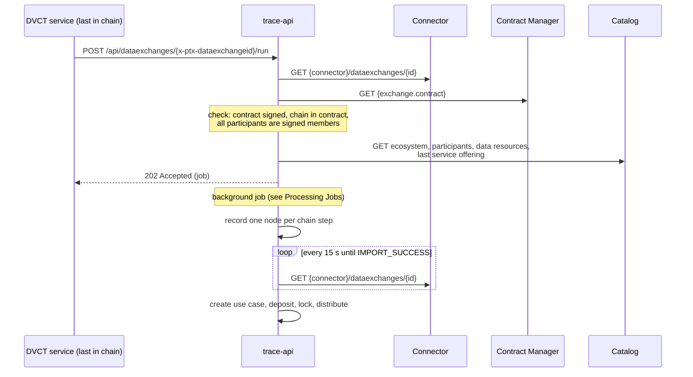

# Data Exchange Integration

The data exchange endpoint lets a participant of a Prometheus-X [service chain](https://github.com/Prometheus-X-association/dataspace-connector/wiki/Service-Chains) record the chain's traceability in DVCT and pay out PTX rewards, by sending nothing more than the id of the data exchange.

DVCT reads everything else itself: the data exchange from the connector, the signed ecosystem contract from the Contract Manager, and the participants, service offerings and data resources from the Catalog. Because participants and weights come from these sources and not from the caller, a caller cannot add participants or change the payout.

It is aimed to handle *automatic* tracking at the end of a service chain. However, there are a few constraints to keep in mind.

- Only data exchanges that run through a **service chain with at least two services** can be processed. Plain point-to-point exchanges are rejected.
- DVCT is expected to be the **last service of the chain**. Something must call DVCT with the data exchange id once the chain reaches it: either the DVCT service's endpoint itself, or a small adapter in front of it (see [Calling DVCT from the chain](#calling-dvct-from-the-chain)).
- Rewards are only paid when the exchange carries both [reward parameters](#reward-parameters-dvctrewardpool-and-dvctweights). Without them, DVCT records traceability only.

> The data exchange endpoint does not replace the [Run Script Protocol](./Run-Script-Protocol). It is the recommended way to integrate with a live data space; the run-script endpoint remains available for workflow engines and testing.

## Prerequisites

To process a data exchange, the following conditions must be met:

- The DVCT operator has enabled the endpoint by setting `PDC_CONNECTOR_DOMAINS`, `CATALOG_API_DOMAINS` and `CONTRACT_API_DOMAINS` (see [Configuration](./Configuration#data-exchange-endpoint)). Every connector, catalog and contract host that DVCT will read from must be listed and reachable over HTTPS.
- The ecosystem contract is **signed** (`status: "signed"`), and the service chain of the exchange is part of it.
- Every participant in the chain (including the participants of `pre` dependencies) is a member of the contract that has signed and has not been revoked.
- The DVCT operator holds a `TRACE_API_TOKEN` and has shared it with the caller.
- For a payout: every participant with a non-zero weight has a `walletAddress` in the [organization registry](./Configuration#organization-registry), using its catalog participant URL as `organizationId` or alias.

## Usage

To process an exchange, call `POST /api/dataexchanges/{dataExchangeId}/run` on trace-api, through the gateway, with the trace-api bearer token.

```bash
curl -X POST "https://YOUR_DVCT_HOST/trace-api/api/dataexchanges/DATA_EXCHANGE_ID/run?connector=https://YOUR_PDC_ENDPOINT" \
-H "Authorization: Bearer TRACE_API_TOKEN"
```

| Query parameter | Required | Description |
|---|---|---|
| `connector` | no | Base URL of the connector that holds the data exchange. Defaults to `PDC_DEFAULT_CONNECTOR`. Its host must be in `PDC_CONNECTOR_DOMAINS` |
| `reachEndFlow` | no | `false` records traceability only, even if reward parameters are set. Default `true` |
| `wait` | no | Seconds (max 60) to wait for the job to make progress before answering |

> Important:
>
> The request has no body. Any participant or weight information has to be in the data exchange itself.

The answer is `202 Accepted` with a job, plus a `resolved` summary of what DVCT read:

```jsonc
{
  "message": "Data exchange accepted",
  "statusUrl": "/api/jobs/1b0f5a1e-6c7d-4c35-9a8f-3b1c2d4e5f60",
  "jobId": "1b0f5a1e-6c7d-4c35-9a8f-3b1c2d4e5f60",
  "status": "queued",
  "step": "trace",
  "dataExchange": {
    "id": "4e39d0a95bd10781b97e6644",
    "providerId": "1fe8e3f84dc443e1b472ea28",
    "connector": "https://connector-b.example.org"
  },
  "result": {},
  "resolved": {
    "dataExchange": {
      "id": "4e39d0a95bd10781b97e6644",
      "providerDataExchangeId": "1fe8e3f84dc443e1b472ea28",
      "connector": "https://connector-b.example.org",
      "status": "IMPORT_SUCCESS",
      "completed": true
    },
    "contractId": "1ede4e4c2b10f3273181b36f",
    "serviceChain": { "id": "32c09a520bca7915f542db7e", "name": "Anonymise and train", "ecosystem": "Skills ecosystem" },
    "participants": [
      { "participantId": "https://catalog.example.org/v1/catalog/participants/4f0d35da82bf80117c855e8b", "name": "Data Provider", "role": "participant", "weight": 50 },
      { "participantId": "https://catalog.example.org/v1/catalog/participants/ec0a6e8d9fb4c9e585310224", "name": "Anonymizer", "role": "participant", "weight": 30 },
      { "participantId": "https://catalog.example.org/v1/catalog/participants/8c0bc413f9be90e93fe691c0", "name": "AI Trainer", "role": "orchestrator", "weight": 20 }
    ],
    "hops": [
      { "from": "https://catalog.example.org/v1/catalog/participants/4f0d35da82bf80117c855e8b", "to": "https://catalog.example.org/v1/catalog/participants/ec0a6e8d9fb4c9e585310224" }
    ],
    "payout": {
      "onChainUseCaseId": "32c09a520bca7915f542db7e:1fe8e3f84dc443e1b472ea28",
      "rewardPool": "100",
      "shares": [
        { "organizationId": "https://catalog.example.org/v1/catalog/participants/4f0d35da82bf80117c855e8b", "walletAddress": "0x14dC79964da2C08b23698B3D3cc7Ca32193d9955", "basisPoints": 5000 },
        { "organizationId": "https://catalog.example.org/v1/catalog/participants/ec0a6e8d9fb4c9e585310224", "walletAddress": "0x23618e81E3f5cdF7f54C3d65f7FBc0aBf5B21E8f", "basisPoints": 3000 },
        { "organizationId": "https://catalog.example.org/v1/catalog/participants/8c0bc413f9be90e93fe691c0", "walletAddress": "0xa0Ee7A142d267C1f36714E4a8F75612F20a79720", "basisPoints": 2000 }
      ]
    }
  }
}
```

`payout` is `null` when the exchange carries no reward parameters or `reachEndFlow=false`. Follow the job with the `statusUrl` (see [Processing Jobs](./Processing-Jobs)).

### Preview before running

`GET /api/dataexchanges/{dataExchangeId}/preview` takes the same query parameters and returns only the `resolved` summary. It writes nothing and pays nothing, so it is the safest way to check a new integration.

```bash
curl "https://YOUR_DVCT_HOST/trace-api/api/dataexchanges/DATA_EXCHANGE_ID/preview?connector=https://YOUR_PDC_ENDPOINT" \
-H "Authorization: Bearer TRACE_API_TOKEN"
```

### How to retrieve the `dataExchangeId`

The data exchange id is the 24-character hexadecimal `_id` of the exchange record in a PDC. Every service in a service chain receives it from its PDC in the `x-ptx-dataexchangeid` header (see the PDC [service chain headers](https://github.com/Prometheus-X-association/dataspace-connector/wiki/Service-Chains#headers)).

Either the consumer-side or the provider-side record can be used. A consumer-side record points to the provider-side one through `providerDataExchange`; DVCT always keys the payout on the provider-side id, so both ids lead to the same job.

## Protocol



### What DVCT reads from the data exchange

| Field | Use |
|---|---|
| `_id`, `providerDataExchange` | Exchange identity. The provider-side id names the on-chain use case |
| `status` | `ERROR`/`FAIL` statuses are rejected. Payout waits for `IMPORT_SUCCESS` |
| `serviceChain.catalogId` | The service chain id. Must be a chain of the contract |
| `serviceChain.services[]` | The chain steps in order: `participant`, `service`, `pre`, `completed` |
| `contract` | URL of the ecosystem contract (its host must be in `CONTRACT_API_DOMAINS`) |
| `resources[]` | Input data resources and the service offering that provides each. They become data-source nodes |
| `params.query` in `purposes[]`, `serviceChainParams[]`, `resources[]`, `providerParams`, `consumerParams` | Where the [reward parameters](#reward-parameters-dvctrewardpool-and-dvctweights) are looked up |

A payout only starts when the exchange status is `IMPORT_SUCCESS` **and** every service in `serviceChain.services` has `completed: true`. If that does not happen within `DATAEXCHANGE_COMPLETION_TIMEOUT_SECONDS` (default 30 minutes), or the status turns into an error, the job fails. Traceability nodes are recorded straight away, before this wait.

### Reward parameters: `dvctRewardPool` and `dvctWeights`

The payout is configured with two query parameters on the exchange. They are usually declared on the DVCT software resource in the catalog (`representation.queryParams`) and given values when the exchange is started, so they end up in one of the `params.query` lists above.

| Parameter | Format | Example |
|---|---|---|
| `dvctRewardPool` | Positive PTX amount, up to 18 decimals, at most `INCENTIVE_MAX_REWARD_POOL` | `100` |
| `dvctWeights` | Raw weight per participant, in one of the two formats below | `50,30,20` |

Both must be set together; setting only one of them is rejected. If the same parameter appears in several places with different values, the exchange is rejected as ambiguous.

**`dvctWeights` formats:**

| Format | Example | Meaning |
|---|---|---|
| Positional | `50,30,20` | One weight per distinct participant, in the order they first appear in the chain. The count must match exactly |
| By participant | `4f0d35da82bf80117c855e8b:50,ec0a6e8d9fb4c9e585310224:30` | `<participant>:<weight>` pairs. `<participant>` is the catalog participant id or full URL. Participants not listed get weight 0 |

Weights are raw points, not percentages. See [Incentive Distribution](./Incentive-Distribution#from-weights-to-basis-points) for how they become on-chain shares.

### What gets recorded

Each chain step becomes one node in the [traceability graph](./Traceability-Graph):

- The step that provides the input data becomes one **data-source node per input data resource**. Data-source nodes are shared: every exchange that uses the same data resource branches off the same node.
- Every other step becomes **one node per service chain and step position**, linked to the step(s) it receives data from (its `pre` dependencies, or else the previous step). Running the same chain again updates these nodes (adds an execution) instead of creating a parallel path.
- A participant that appears in several steps gets a node for each step, so a chain such as A → B → A stays a path and never becomes a cycle. Its points are only counted on its first node.

#### The DVCT step is not recorded

The last step of the chain is treated as DVCT itself and left out of the graph when its service offering is listed in `DVCT_SERVICE_OFFERINGS`, or when one of its software resources declares `dvctRewardPool` or `dvctWeights` in `representation.queryParams`. Steps that would read from it are linked to its inputs instead.

### One payout per exchange

The on-chain use case id is `<serviceChainId>:<providerDataExchangeId>`. Calling `/run` again for the same exchange returns the existing job (`200`, `"Data exchange already received"`) instead of paying twice. Calling once with `reachEndFlow=false` and later without it creates two jobs: one that only traces and one that pays.

## Calling DVCT from the chain

The PDC calls each service's endpoint with the chain context in headers, including `x-ptx-dataexchangeid`. The trace-api route takes the id in its path and requires a bearer token, so the DVCT service in the chain needs a small layer that:

1. Acknowledges the incoming request from its PDC.
2. Reads the `x-ptx-dataexchangeid` header.
3. Calls `POST /trace-api/api/dataexchanges/{id}/run` with `Authorization: Bearer TRACE_API_TOKEN` (and `?connector=` if the exchange is not on the default connector).

Because DVCT is the last service in the chain, it does not need to resume the chain afterwards. If DVCT is called before the other services have finished, that is fine: the payout waits until the connector reports the exchange as complete.

## Errors

| Status | Cause |
|---|---|
| `400` | The id is not a 24-character hex id; the exchange failed, is not a service chain, or does not match its contract; a reward parameter is invalid; a paid participant has no wallet |
| `401` | Missing or wrong bearer token |
| `502` | A connector, contract or catalog request failed, was redirected, was not HTTPS, pointed to a host outside the allow-lists or to a private address, or returned an unexpected document |
| `503` | The endpoint is not configured (the three domain lists are not all set) |

```json
{ "error": "Participant https://catalog.example.org/v1/catalog/participants/66d18a1dee71f9f096baec09 is not a signed member of contract 1ede4e4c2b10f3273181b36f" }
```
