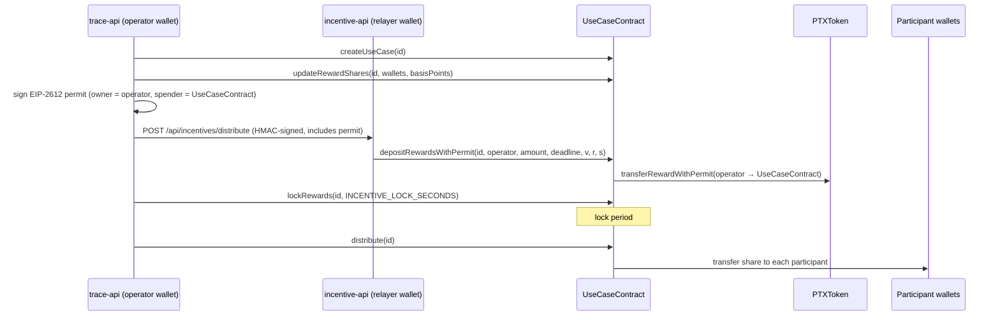

# Incentive Distribution

When an exchange carries a reward pool and weights, DVCT pays each participant a share of the pool in PTX tokens. The payout is fully automatic: trace-api creates and funds an on-chain use case, locks it, and pushes the tokens to every participant's wallet once the lock has ended. Participants do not need to do anything, and DVCT never holds their private keys.

## Inputs

| Input | Data exchange endpoint | Run-script endpoint |
|---|---|---|
| Reward pool (PTX) | `dvctRewardPool` query parameter | `rewardPool` field (default `INCENTIVE_DEFAULT_REWARD_POOL`) |
| Weight per participant | `dvctWeights` query parameter | `participantShare[].numOfShare` |
| Wallet per participant | Organization registry | Organization registry |
| On-chain use case id | `<serviceChainId>:<providerDataExchangeId>` | `useCaseName` |

## From weights to basis points

Weights are **raw points**, not percentages: `50,30,20` and `5,3,2` produce the same payout. The contract, however, expects shares in basis points (10000 = 100%). trace-api converts them as follows:

1. Participants with weight `0` are left out. They need no wallet.
2. Each remaining participant is resolved to its wallet in the [organization registry](./Configuration#organization-registry). A missing wallet stops the request with `400`.
3. Participants that resolve to the **same wallet** are merged and their weights added.
4. Each wallet's share is `weight / totalWeight × 10000`, rounded down.
5. The basis points still missing to reach exactly 10000 are given, one each, to the wallets with the largest rounding remainders (largest-remainder method).

The smart contract then pays each participant `rewardPool × basisPoints / 10000`.

### Worked example

Reward pool `3200` PTX, weights `800`, `500`, `900`, `1000` (total `3200`):

| Participant | Weight | Exact share | Rounded down | + remainder | Basis points | PTX paid |
|---|---|---|---|---|---|---|
| A | 800 | 2500.0 | 2500 | | 2500 | 800.00 |
| B | 500 | 1562.5 | 1562 | +1 | 1563 | 500.16 |
| C | 900 | 2812.5 | 2812 | | 2812 | 899.84 |
| D | 1000 | 3125.0 | 3125 | | 3125 | 1000.00 |
| **Total** | 3200 | | 9999 | | **10000** | **3200.00** |

B and C have the same remainder (0.5); the first one in order receives the extra basis point. The small difference from the "ideal" 500 / 900 comes from expressing shares with a precision of 0.01%.

## Where the weights are shown

| Place | Shows |
|---|---|
| Core frontend (`/core/`) | The raw weight (`participantShare`) on each node, never converted |
| Incentive frontend (`/incentive`) | The raw weight (from the use-case metadata stored by trace-api) next to the PTX actually paid |
| Smart contract | Basis points only |

## On-chain flow

### Wallets involved

| Wallet | Key held by | Role |
|---|---|---|
| Operator (`TRACE_OPERATOR_ADDRESS`) | trace-api | Owns every use case trace-api creates and funds its reward pool from its own PTX balance. Pays gas for create, shares, lock and distribute |
| Relayer (`INCENTIVE_RELAYER_ADDRESS`) | incentive-api | Has `RELAYER_ROLE` on the contract. Submits the permit deposit and pays its gas. Can only move tokens their owner has signed a permit for |
| Participant | The participant | Receives PTX. DVCT only knows its address |

On the local chain, the `hardhat` container funds both service wallets with ETH for gas and tops the operator up to 100000 PTX at every start.

### Lock period

After the deposit, the use case is locked for `INCENTIVE_LOCK_SECONDS` (default 60 seconds, maximum 365 days). While locked, shares and deposits are frozen. During the lock the job is in status `waiting`; once the lock has ended trace-api calls `distribute`, which pushes every participant's tokens in a single transaction.

Participants could also pull their own reward with `claimRewards` after the lock; `distribute` skips anyone who already claimed.

## Checking a payout

- **Job result**: `GET /trace-api/api/jobs/{jobId}` lists `payouts` (wallet and PTX amount), the deposit and distribute transaction hashes and `unlockAt`. See [Processing Jobs](./Processing-Jobs).
- **Incentive frontend**: `http://localhost:3000/incentive` shows all use cases, their participants, the remaining pool and the claimed amounts, read from `RewardsClaimed` and other contract events.
- **Use-case metadata**: signed-in members of a use case can read `GET /api/incentive-use-case-metadata/{useCaseId}` for the raw weights and wallets.
