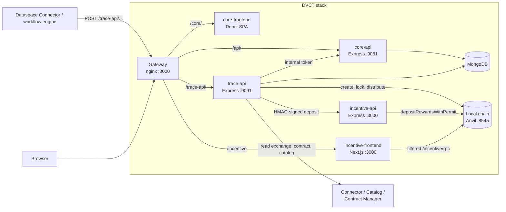
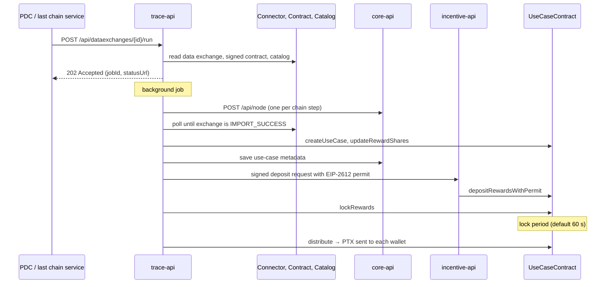

# Overview

DVCT answers two questions about every data exchange that happens in a Prometheus-X data space:

1. **Where did the data come from, and who processed it?** DVCT records each exchange as nodes in a graph. A node is one organization's step in a chain: providing raw data, transforming it, or consuming it. Edges point from the data source to the steps that used it.
2. **Who should be rewarded, and by how much?** Each participant is given a weight. DVCT turns the weights into shares, funds an on-chain reward pool in PTX tokens, and pushes each participant's share to its wallet once a lock period has ended.

## Concepts

| Term | Meaning |
|---|---|
| **Node** | One organization's step in a data value chain, stored in MongoDB as a JSON-LD document. See [Traceability Graph](./Traceability-Graph). |
| **Data value chain** | The graph of nodes linked from data source (parent) to processing and consumption (children). |
| **Service chain** | A Prometheus-X sequence of services, defined in the catalog and included in an ecosystem contract, that a data exchange runs through. DVCT is usually the last service in the chain. |
| **Use case (on-chain)** | A reward pool in the `UseCaseContract`, identified by a string id. DVCT creates one use case per paid-out exchange. |
| **Weight (`numOfShare`)** | A raw number of points given to a participant. It is **not** a percentage. DVCT normalizes all weights into basis points (10000 = 100%) before calling the contract. |
| **PTX** | The ERC-20 token used for rewards. |
| **Organization registry** | `config/organizations.json`: maps organization identifiers to display names, wallet addresses and login users. |

## Architecture

The stack is a set of Docker containers. Only the gateway publishes a port; every other service is reachable only on the internal `core-network`.

| Service | Source | Role |
|---|---|---|
| Gateway + core-frontend | `app/` (`Dockerfile.frontend`, `nginx.conf`) | nginx serving the React graph viewer at `/core/` and routing `/api/`, `/trace-api/` and `/incentive` to the internal services. Adds security headers and rate limits. |
| core-api | `app/express-server` | Stores and serves the traceability graph. Browser users sign in with a session cookie; only trace-api may write nodes. |
| trace-api | `trace-api/` | Entry point for the data space. Validates incoming events, records traceability through core-api and runs the payout on-chain as a persisted, retried job. |
| incentive-api | `incentive/api` | Relays permit-signed reward deposits to the `UseCaseContract`. Only accepts HMAC-signed requests from trace-api. |
| incentive-frontend | `incentive/frontend` | Wallet-connected UI under `/incentive` that shows use cases, participants and claimed rewards from on-chain events. |
| hardhat (Anvil) | `incentive/blockchain` | Local demonstrator chain with the `PTXToken` and `UseCaseContract` deployed. State persists in a Docker volume. |
| mongodb | `mongo:8.0.13` | Databases `jsonldDB` (graph, sessions, use-case metadata) and `dvctTrace` (trace-api jobs). |

## How a data exchange is processed

There are two ways to submit an exchange:

- **[Data Exchange Integration](./Data-Exchange-Integration)** (recommended): the caller sends only the PDC data exchange id. trace-api reads everything else from the connector, the signed contract and the catalog, so participants and weights cannot be forged by the caller.
- **[Run Script Protocol](./Run-Script-Protocol)**: the caller sends a complete payload with participants and weights. Use it for workflow engines and testing.

Both create the same kind of [processing job](./Processing-Jobs).
