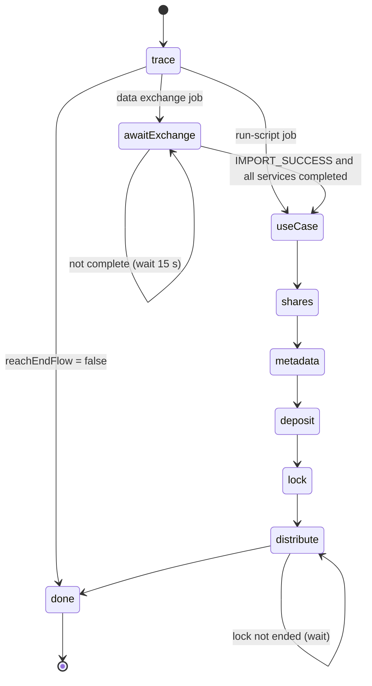

# Processing Jobs

trace-api never records or pays inside the HTTP request. Each accepted event becomes a **job**, stored in MongoDB (database `dvctTrace`, collection `traceJobs`) and processed in the background. Jobs survive restarts, are retried on temporary errors, and run one at a time so the operator wallet never sends two transactions at once.

## Following a job

Every accepted request returns a `statusUrl`. Query it with the same bearer token:

```bash
curl "https://YOUR_DVCT_HOST/trace-api/api/jobs/JOB_ID" \
-H "Authorization: Bearer TRACE_API_TOKEN"
```

A finished payout looks like this:

```jsonc
{
  "jobId": "6c1e0f7a-5d43-4f0e-8a51-0b6a0d1b9c2e",
  "status": "succeeded",
  "step": "done",
  "createdAt": "2026-11-18T10:15:02.118Z",
  "updatedAt": "2026-11-18T10:16:09.402Z",
  "dataExchange": {                   // only for data exchange jobs
    "id": "4e39d0a95bd10781b97e6644",
    "providerId": "1fe8e3f84dc443e1b472ea28",
    "connector": "https://connector-b.example.org"
  },
  "result": {
    "traceNodes": [                   // canonical keys of the recorded nodes
      "trace-source:https://catalog.example.org/v1/catalog/dataresources/3c06b0f8576f5ad9bba5c8d2:https://catalog.example.org/v1/catalog/participants/4f0d35da82bf80117c855e8b",
      "trace-node:32c09a520bca7915f542db7e:step-1:https://catalog.example.org/v1/catalog/participants/ec0a6e8d9fb4c9e585310224"
    ],
    "useCaseId": "32c09a520bca7915f542db7e:1fe8e3f84dc443e1b472ea28",
    "rewardPool": "100",
    "depositTransaction": "0x5d1f...e2a7",
    "unlockAt": "2026-11-18T10:16:05.000Z",
    "distributeTransaction": "0x9b0c...41f3",
    "payouts": [
      { "walletAddress": "0x14dC79964da2C08b23698B3D3cc7Ca32193d9955", "amount": "50.0" },
      { "walletAddress": "0x23618e81E3f5cdF7f54C3d65f7FBc0aBf5B21E8f", "amount": "30.0" },
      { "walletAddress": "0xa0Ee7A142d267C1f36714E4a8F75612F20a79720", "amount": "20.0" }
    ]
  }
}
```

## Status

| Status | Meaning |
|---|---|
| `queued` | Waiting to be picked up, or waiting for a retry (`error.retrying` is `true`) |
| `running` | Being processed |
| `waiting` | Paused on purpose until `nextRunAt`: the exchange is not complete yet, or the lock period has not ended |
| `succeeded` | All steps done. Final |
| `failed` | Stopped. `error.step` and `error.message` say where and why. Final |

## Steps



| Step | What it does |
|---|---|
| `trace` | Writes the traceability nodes to core-api |
| `awaitExchange` | Data exchange jobs only. Polls the connector every 15 s until the exchange is complete. Fails after `DATAEXCHANGE_COMPLETION_TIMEOUT_SECONDS` or on an error status |
| `useCase` | Reserves the use case id so no other job can pay it, then creates the on-chain use case owned by the operator wallet. Fails if another job already paid the same id, or if the id exists on-chain with a different owner |
| `shares` | Sets the participants' wallets and basis-point shares on the contract (skipped if already identical) |
| `metadata` | Stores the use case's participants, raw weights and wallets in core-api, so the incentive UI can show the raw weights next to the PTX paid |
| `deposit` | Signs an EIP-2612 permit for the reward pool and has incentive-api relay the deposit. Only the missing amount is deposited |
| `lock` | Locks the use case for `INCENTIVE_LOCK_SECONDS` |
| `distribute` | After the lock has ended, pushes every participant's PTX to its wallet and records the payouts |

Every step checks the chain before acting, so a step that is repeated after a crash does not create, deposit or distribute twice.

## Errors and retries

| Kind | Examples | Behaviour |
|---|---|---|
| Temporary | core-api or chain unreachable, a connector timeout, incentive-api `5xx` | Retried up to 5 attempts, waiting 5 s, 10 s, 20 s, 40 s. Then `failed` |
| Permanent | Use case already paid or owned by someone else, operator wallet out of PTX, incentive-api `4xx`, exchange failed or timed out, invalid data | `failed` immediately |

A failed job is not resumed automatically, and sending the same event again returns the same failed job (the idempotency key has not changed). After fixing the cause:

- **Run-script events:** send the event again with a different `dvctId`. A failed job does not block its `useCaseName`, so the new job can pay it. Note that the nodes then also count the points of the new `dvctId`.
- **Data exchange events:** the job key is fixed per exchange (one for tracing, one for paying), so a failed job cannot be re-created through the API. Remove the failed job from the `traceJobs` collection first, then call `/run` again.

> If the operator wallet runs out of PTX, the job fails with `Operator 0x... holds X PTX but Y PTX are needed`. On the local chain, restarting the `hardhat` container tops the operator up to 100000 PTX.
