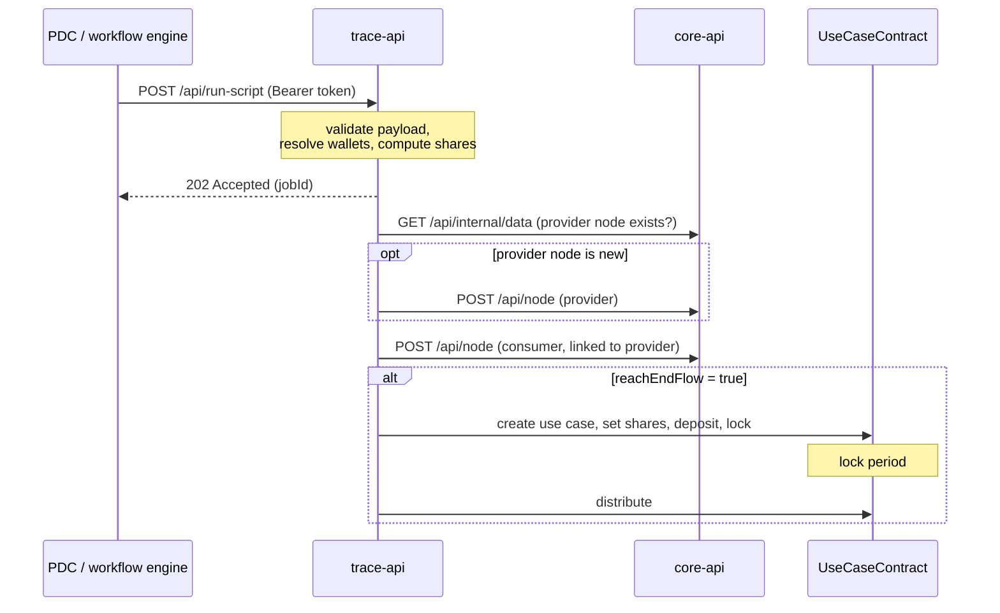

# Run Script Protocol

`POST /api/run-script` is the original DVCT entry point. The caller sends a complete description of one data exchange: who provided the data, who consumed it, and the weight of every participant. DVCT records the provider and consumer nodes and, when `reachEndFlow` is `true`, pays out the reward pool.

Unlike the [Data Exchange Integration](./Data-Exchange-Integration), DVCT does not check this payload against the data space: it trusts the caller. Use it for workflow engines that already know the participants, and for testing.

## Prerequisites

- A `TRACE_API_TOKEN` from the DVCT operator.
- For a payout (`reachEndFlow: true`): every participant with a non-zero `numOfShare` has a `walletAddress` in the [organization registry](./Configuration#organization-registry), matched by `participantId`.

## Usage

```bash
curl -X POST "https://YOUR_DVCT_HOST/trace-api/api/run-script" \
-H "Authorization: Bearer TRACE_API_TOKEN" \
-H "Content-Type: application/json" \
-d @payload.json
```

Add `?wait=<seconds>` (max 60) to wait for the job to make progress before the answer is sent.

### Payload

```jsonc
{
  "dvctId": "123",
  "contractId": "6842ae6be580d1de74b20026",
  "useCaseContractTitle": "Skills analysis",
  "dataId": "http://localhost:4040/v1/catalog/dataresources/66d18a1dee71f9f096baec99",
  "dataProviderId": "http://localhost:4040/v1/catalog/participants/66d18724ee71f9f096bae810",
  "dataConsumerId": "http://localhost:4040/v1/catalog/participants/66d18a1dee71f9f096baec07",
  "factorCheck": true,
  "reachEndFlow": true,
  "providerUrl": "n/a",
  "currentParticipantId": "http://localhost:4040/v1/catalog/participants/66d18724ee71f9f096bae810",
  "nextParticipantId": "http://localhost:4040/v1/catalog/participants/66d18a1dee71f9f096baec07",
  "useCaseId": "http://localhost:4040/v1/catalog/ecosystems/6842ae6a877da765ec2f38bf",
  "useCaseName": "skills-analysis-2026-11-18",
  "dataQualityCheck": "n/a",
  "rewardPool": "100",                 // optional, PTX
  "participantShare": [
    {
      "participantName": "ParticipantOne",
      "role": "orchestrator",
      "participantId": "http://localhost:4040/v1/catalog/participants/66d18a1dee71f9f096baec08",
      "numOfShare": 17
    },
    {
      "participantName": "Test-DataProvider",
      "role": "participant",
      "participantId": "http://localhost:4040/v1/catalog/participants/66d18724ee71f9f096bae810",
      "numOfShare": 41
    },
    {
      "participantName": "Test-Infrastructure",
      "role": "infrastructure provider",
      "participantId": "http://localhost:4040/v1/catalog/participants/66d18a1dee71f9f096baec07",
      "numOfShare": 10
    }
  ]
}
```

| Field | Type | Description |
|---|---|---|
| `dvctId` | string | Identifier of this event (e.g. the data exchange id) |
| `contractId` | string | Contract the exchange runs under |
| `useCaseContractTitle` | string | Title shown on the nodes |
| `dataId` | string | Identifier of the data that was exchanged |
| `dataProviderId` | string | Organization that provided the data (becomes the parent node) |
| `dataConsumerId` | string | Organization that received the data (becomes the child node) |
| `currentParticipantId` | string | Participant id whose `numOfShare` is credited to the provider node |
| `nextParticipantId` | string | Participant id whose `numOfShare` is credited to the consumer node |
| `useCaseId` | string | Use case or ecosystem the exchange belongs to. Groups nodes in the graph |
| `useCaseName` | string | **Id of the on-chain use case.** Each use case is paid out only once (see below) |
| `reachEndFlow` | boolean | `true` = record and pay out; `false` = record only |
| `factorCheck`, `providerUrl`, `dataQualityCheck` | any | Required for compatibility; not used |
| `rewardPool` | string or number | Optional. PTX to distribute, up to 18 decimals, at most `INCENTIVE_MAX_REWARD_POOL`. `rewardPoolAmount` and `rewardAmount` are accepted as aliases. Default: `INCENTIVE_DEFAULT_REWARD_POOL` (1000) |
| `participantShare[]` | array | 1 to 100 participants |
| `participantShare[].participantId` | string | Required. Matched against the organization registry to find the wallet |
| `participantShare[].numOfShare` | number | Required, ≥ 0. Raw weight, **not** a percentage |
| `participantShare[].participantName`, `.role` | string | Optional. Shown in the UIs |

All string fields are limited to 2048 characters. `participantWallet` and `rewardDepositor`, which appear in older examples, are ignored: wallets always come from the registry, never from the payload.

### Answer

```jsonc
// 202 Accepted (new event) or 200 OK (same event already received, or already finished)
{
  "message": "Event accepted",
  "statusUrl": "/api/jobs/6c1e0f7a-5d43-4f0e-8a51-0b6a0d1b9c2e",
  "jobId": "6c1e0f7a-5d43-4f0e-8a51-0b6a0d1b9c2e",
  "status": "queued",
  "step": "trace",
  "createdAt": "2026-11-18T10:15:02.118Z",
  "updatedAt": "2026-11-18T10:15:02.118Z",
  "result": {}
}
```

Validation, including the wallet lookup, happens before the job is created, so a `400` means nothing was recorded:

```json
{ "error": "No wallet address registered for participant \"http://localhost:4040/v1/catalog/participants/66d18a1dee71f9f096baec09\"" }
```

## Protocol



### Nodes recorded

Each call records up to two nodes:

| Node | `participantId` | Points | Parent |
|---|---|---|---|
| Provider | `dataProviderId` | `numOfShare` of `currentParticipantId` | none |
| Consumer | `dataConsumerId` | `numOfShare` of `nextParticipantId` | the provider node |

The provider node is identified by `trace-node:<useCaseId>:<dataId>:<dataProviderId>`. If it already exists (for example because an earlier call recorded it as a consumer), it is reused, which is how calls chain together: send A → B, then B → C with the same `useCaseId` and `dataId`, and the graph shows A → B → C.

### Idempotency

Two calls with the same `dvctId`, `contractId`, `useCaseId`, `useCaseName`, `dataId`, `dataProviderId`, `dataConsumerId`, `currentParticipantId`, `nextParticipantId` and `reachEndFlow` describe the same event. The second call returns the first call's job with `"Event already received"` and does nothing else. Retrying a call after a timeout is therefore safe.

### One payout per `useCaseName`

`useCaseName` is used as the on-chain use case id, and each on-chain use case can be paid out only once. A second event with `reachEndFlow: true` and the same `useCaseName` (but different other fields) is recorded in the graph, then fails at the `useCase` step with:

```
Use case "skills-analysis-2026-11-18" is settled by job 6c1e0f7a-...; each use case is paid out once
```

Use a fresh `useCaseName` for every payout, for example by appending the exchange id or date. To record several hops of the same chain and pay once, send the intermediate hops with `reachEndFlow: false` and only the final one with `reachEndFlow: true`.
