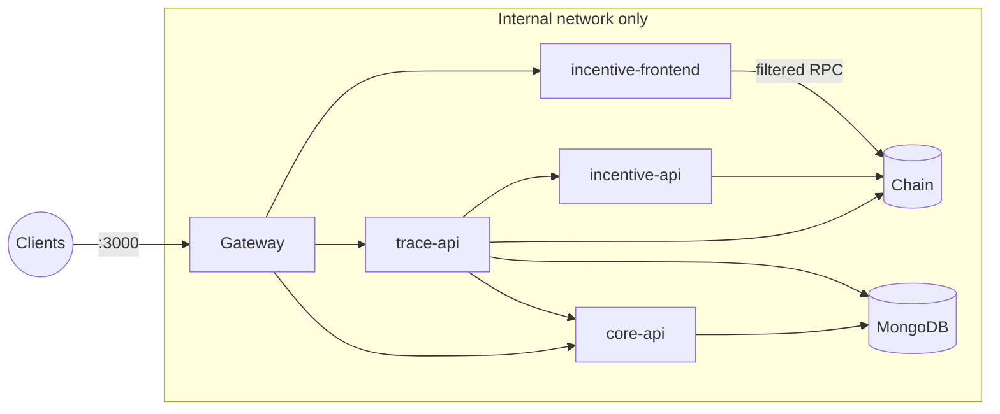

# Security Model

DVCT has three kinds of callers, and each one authenticates differently:

| Caller | Talks to | Authentication |
|---|---|---|
| Browser user | core-api (`/api/...`) | Session cookie from `POST /api/auth/login` |
| PDC, chain service or workflow engine | trace-api (`/trace-api/...`) | `Authorization: Bearer TRACE_API_TOKEN` |
| trace-api | core-api internal routes | `X-DVCT-Internal-Token: DVCT_INTERNAL_API_TOKEN` |
| trace-api | incentive-api | HMAC-SHA256 request signature with `INCENTIVE_API_HMAC_SECRET` |

All tokens and secrets are random 32-byte values generated by `make init`. Services refuse to start when one is missing or shorter than 32 characters.

## Network exposure



- Only the gateway publishes a port. incentive-api, MongoDB and the chain node cannot be reached from outside.
- The gateway does not route to incentive-api at all; only trace-api calls it.
- Terminate TLS in front of the gateway for any deployment reachable by others, and set `DVCT_SESSION_SECURE=true`.

### Gateway protections

| Protection | Setting |
|---|---|
| Rate limit on `POST /api/auth/login` | 10 requests per minute per IP (burst 5), then `429` |
| Rate limit on `/trace-api/` | 10 requests per second per IP (burst 20), then `429` |
| Request body limit | 1 MB (services apply tighter limits: 256 KB for core-api and trace-api, 64 KB for incentive-api) |
| Headers | `Content-Security-Policy` (core frontend), `X-Frame-Options: DENY`, `X-Content-Type-Options: nosniff`, `Referrer-Policy`, `Permissions-Policy` |

## Browser sessions

- `POST /api/auth/login` checks the username and password against the scrypt hashes in the [organization registry](./Configuration#organization-registry) and sets an `HttpOnly`, `SameSite=Strict` cookie (`Secure` when `DVCT_SESSION_SECURE=true`). There is no HTTP Basic Auth popup.
- Sessions are stored in MongoDB by a hash of the token and expire after 8 hours (`DVCT_SESSION_TTL_MS`). `POST /api/auth/logout` deletes the session.
- After 10 failed sign-ins for a username within 15 minutes (`DVCT_LOGIN_MAX_FAILURES`), or 50 from one IP, sign-in answers `429`.
- State-changing requests (`login`, `logout`, `DELETE /api/data/...`) that carry an `Origin` or `Referer` header from another site are rejected with `403`, unless the origin is in `DVCT_CORS_ORIGINS`.
- Graph data is filtered per organization on the server (see [Traceability Graph](./Traceability-Graph#who-can-see-what)).

## trace-api

- Every route except `/health` requires the bearer token, compared in constant time.
- Payloads are validated before a job is created: field types, string lengths (2048), at most 100 participants, reward pool limits.
- Wallets always come from the organization registry. Wallet addresses in a payload are ignored, so a caller cannot redirect rewards.
- On the data exchange endpoint, participants and weights come from the connector and the signed contract. Every chain participant must be a signed, non-revoked member of the contract.

### Outgoing requests to the data space

URLs found in data exchanges and contracts are followed, so trace-api restricts what it will fetch:

- HTTPS only, with no credentials in the URL.
- Only hosts listed in `PDC_CONNECTOR_DOMAINS`, `CATALOG_API_DOMAINS` or `CONTRACT_API_DOMAINS` (per document type).
- The host must resolve to a public address; loopback, private, link-local and multicast ranges are refused (unless `DATASPACE_ALLOW_PRIVATE_NETWORKS=true` for local testing).
- Redirects are not followed, responses are limited to 2 MB and requests time out after 10 seconds.
- From catalog participant documents only the `legalName` is kept.

## incentive-api

incentive-api only accepts requests signed by trace-api:

```
X-DVCT-Timestamp: <unix time in seconds>
X-DVCT-Signature: hex(HMAC_SHA256(INCENTIVE_API_HMAC_SECRET, "<timestamp>.<raw request body>"))
```

- Requests whose timestamp is more than 5 minutes off are rejected (`401`).
- Each signature is accepted once; a replay answers `409`.
- The deposit must target the configured `UseCaseContract`, and the permit's owner, spender and amount must match the request.
- The relayer wallet can only move tokens whose owner signed a permit for that exact amount, so a compromised incentive-api cannot spend anybody's PTX without a matching signature.

## Chain RPC

The Anvil node accepts "cheat" methods (`anvil_setBalance`, `evm_increaseTime`, `anvil_impersonateAccount`, ...) that would let anyone act as any account. It is therefore never published. Browsers reach it through `/incentive/rpc`, which:

- forwards only standard read methods (`eth_call`, `eth_getLogs`, `eth_getBalance`, ...) and `eth_sendRawTransaction` (transactions already signed by the user's wallet);
- limits request size (128 KB) and batch size (50);
- forwards dev signing methods (`eth_sendTransaction`, `eth_signTypedData_v4`, ...) only when `RPC_ALLOW_DEV_SIGNING=true`, which `make up-dev` sets for the local wallet switcher.

## Secrets handling

| File | Contains | Commit? |
|---|---|---|
| `.env` | All service secrets and the two service private keys | Never |
| `config/organizations.json` | Registry with password hashes and wallet addresses | Never |
| `config/dev-credentials.local.txt` | Plain login passwords | Never |
| `config/organizations.example.json` | Template without hashes | Yes |

All three generated files are gitignored. Report security vulnerabilities as described in [SECURITY.md](https://github.com/Prometheus-X-association/data-value-chain-tracker/blob/main/SECURITY.md), not in public issues.
