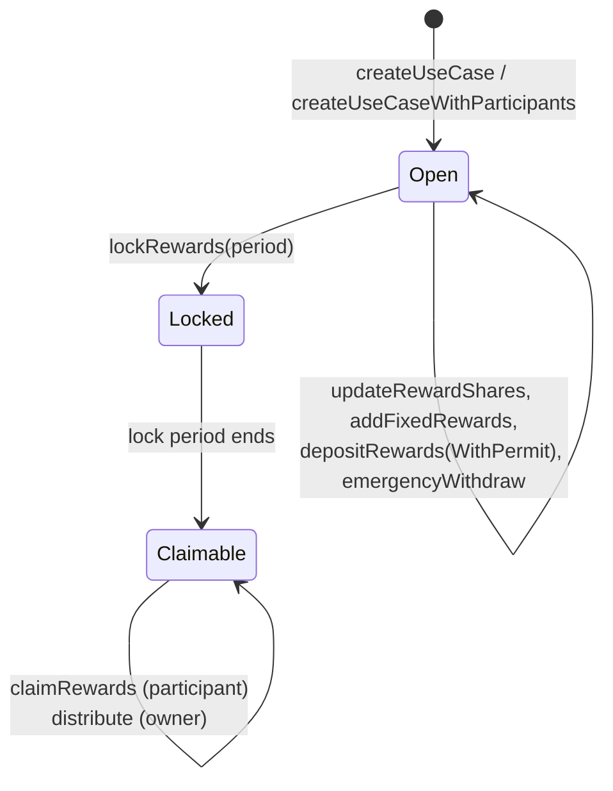

# Smart Contracts

The incentive mechanism is implemented by two Solidity contracts in `incentive/blockchain/src`. In the demonstrator they run on a local Anvil chain inside the `hardhat` container. Generated reference documentation is in [`incentive/blockchain/docs`](https://github.com/Prometheus-X-association/data-value-chain-tracker/blob/main/incentive/blockchain/docs/src/src/README.md) (regenerate with `yarn docs`).

## PTXToken

An ERC-20 token with the ERC-2612 `permit` extension (OpenZeppelin `ERC20Permit`).

- The whole supply is minted to the deployer.
- `transferReward` and `transferRewardWithPermit` wrap a transfer and emit a `RewardTransfer` event, so reward movements can be told apart from ordinary transfers.
- `permit` lets a token owner approve a spender with an off-chain signature. DVCT uses it so the operator wallet can fund a use case through the relayer in one transaction.

## UseCaseContract

Holds one reward pool per **use case**, identified by a string id. It uses OpenZeppelin `AccessControl` (for `RELAYER_ROLE`) and `ReentrancyGuard`. Every use case is accounted for separately: the total paid out of a use case can never exceed the tokens deposited into it, even though all use cases share one token balance.

### Limits

| Constant | Value |
|---|---|
| `MAX_PARTICIPANTS` | 100 per use case |
| `MAX_TOTAL_SHARES` | 10000 (100%) |
| `MIN_LOCKUP_PERIOD` | 60 seconds |
| `MAX_LOCKUP_PERIOD` | 365 days |

### Lifecycle



### Functions

| Function | Caller | Description |
|---|---|---|
| `createUseCase(id)` | anyone | Creates an empty use case owned by the caller |
| `createUseCaseWithParticipants(id, participants, shares, fixedRewards)` | anyone | Creates a use case with participants, shares and fixed rewards |
| `transferUseCaseOwnership(id, newOwner)` | owner | Hands the use case to another address |
| `updateRewardShares(id, participants, shares)` | owner, not locked | Replaces all participants and shares. Clears fixed rewards. Shares may total at most 10000 |
| `addFixedRewards(id, participants, amounts)` | owner, not locked | Adds a fixed PTX amount for existing participants |
| `depositRewards(id, amount)` | anyone, not locked | Adds the caller's PTX to the pool |
| `depositRewardsWithPermit(id, owner, amount, deadline, v, r, s)` | `owner` or `RELAYER_ROLE`, not locked | Adds `owner`'s PTX to the pool using `owner`'s permit signature. Used by incentive-api |
| `lockRewards(id, period)` | owner, not locked | Freezes the use case for `period` seconds. Fails if fixed rewards exceed the pool |
| `claimRewards(id)` | participant | After the lock, pays the caller its outstanding reward |
| `distribute(id)` | owner | After the lock, pays every participant its outstanding reward. Used by trace-api |
| `emergencyWithdraw(id)` | depositor, not locked | Refunds the caller's own deposit. A use case owner cannot take other depositors' funds |
| `getUseCaseInfo(id)`, `getMultipleUseCaseInfo(ids)`, `getParticipantInfo(id, participant)` | anyone | Read the use case, its participants and pools |

### Reward calculation

When a participant is paid (by `claimRewards` or `distribute`):

```
sharePool        = totalRewardPool − totalFixedRewards
shareBasedReward = sharePool × participant.rewardShare / totalShares
reward           = shareBasedReward + participant.fixedReward
```

Each participant is paid at most once; its share and fixed reward are set to zero afterwards. The total paid can never exceed the deposits.

### Events

| Event | Emitted when |
|---|---|
| `UseCaseCreated(id, owner)` | A use case is created |
| `RewardsDeposited(useCaseId, amount)` | PTX is added to a pool |
| `RewardSharesUpdated(useCaseId, participant, shares)` | A participant's share is set |
| `FixedRewardAdded(useCaseId, participant, amount)` | A fixed reward is added |
| `RewardsLocked(useCaseId, lockupPeriod)` | A use case is locked |
| `RewardsClaimed(useCaseId, participant, amount)` | A participant is paid (by claim or distribute) |
| `UseCaseOwnershipTransferred(useCaseId, previousOwner, newOwner)` | Ownership changes |
| `EmergencyWithdrawal(useCaseId, depositor, amount)` | A deposit is refunded |

The incentive frontend builds its views from these events.

## Deployment

On first start the `hardhat` container (`incentive/blockchain/startup.sh`):

1. Starts Anvil with its state stored in the `chain_data` volume.
2. If there is no saved state, deploys the contracts and some demo use cases (`script/deployTestEnv.ts`).
3. Runs `script/bootstrapServices.ts`: gives the relayer gas and `RELAYER_ROLE`, gives the operator gas and PTX.
4. Reports healthy, which lets trace-api, incentive-api and the incentive frontend start.

Anvil's RPC is not published. Browsers reach the chain only through the incentive frontend's `/incentive/rpc` route, which forwards standard read methods and pre-signed transactions only (see [Security Model](./Security-Model#chain-rpc)).

### Commands (`incentive/blockchain`)

| Command | Effect |
|---|---|
| `yarn ptx-deploy` | Deploy the contracts to a local node |
| `yarn ptx-deploy-test` | Deploy plus a test environment with many transactions (useful for frontend work) |
| `yarn export-abis` / `yarn export-abis-to-api` | Copy the ABIs to the incentive frontend / incentive API |
| `yarn docs` | Generate the Solidity documentation with Forge |
| `npx hardhat test` | Hardhat contract tests |
| `forge test` | Foundry unit tests |

> When you change a contract's interface, regenerate and export the ABIs instead of editing `abis.ts` by hand, and update both the Foundry (`test/*.t.sol`) and Hardhat (`test/*.test.ts`) tests.
