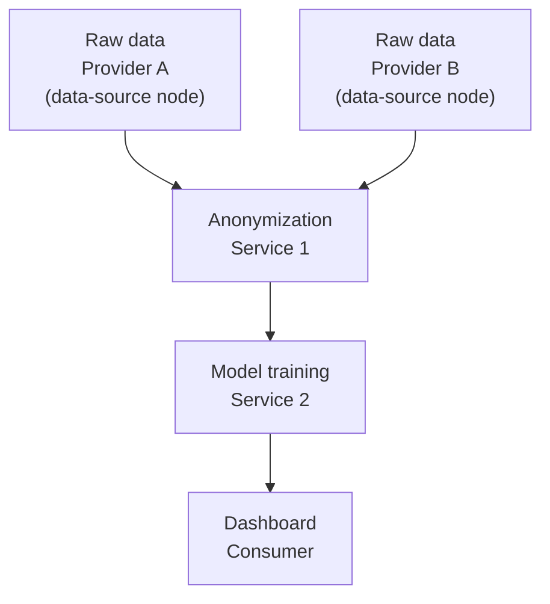

# Traceability Graph

core-api stores every recorded step of a data value chain as a **node** in MongoDB (database `jsonldDB`, collection `datas`). Nodes are linked from the data source (parent) to the steps that used its data (children). The core frontend at `/core/` draws this graph for the signed-in organization.

The concept follows the linked data value chain of Latif et al. (2009): raw data from a provider is refined by one or more processing steps before it reaches a consumer. See the [design document](https://github.com/Prometheus-X-association/data-value-chain-tracker/blob/main/docs/design-document.md#conceptual-overview) for the background.



## Who writes nodes

Only trace-api writes the graph, through `POST /api/node` with the internal token. Nodes are never created directly by the PDC or by browser users. See [Data Exchange Integration](./Data-Exchange-Integration#what-gets-recorded) and [Run Script Protocol](./Run-Script-Protocol#nodes-recorded) for which nodes each entry point creates.

## Node identity

Each node has a **canonical key** that is derived from its content. Writing a node whose key already exists merges into the existing node instead of creating a new one. This makes recording idempotent and lets separate events share nodes.

| Kind | Canonical key | Shared by |
|---|---|---|
| Data source | `trace-source:<dataId>:<participantId>` | Every exchange, chain and use case that uses this data resource from this provider |
| Chain step | `trace-node:<useCaseId>:<dataId>:<participantId>` | Every run of the same chain (data exchanges use `dataId = step-<n>` and the service chain id as `useCaseId`) |

When the input lacks some of these fields, core-api falls back to `trace-node:<dvctId>:<dataId>:<participantId>`, then to a relationship or `data:`/`usecase:`/`dvct:` key.

Each node also has a random `nodeId`. Links (`prevNode`, `childNode`) use the canonical key. The read endpoints accept a node's `nodeId`, canonical key or `dataId`.

## Node document

```jsonc
{
  "@context": { "@vocab": "https://example.org/vocab#", "...": "..." },
  "@type": "Node",
  "nodeId": "6740a1f2c3d4e5f6a7b8c9d0",
  "canonicalKey": "trace-node:32c09a520bca7915f542db7e:step-1:https://catalog.example.org/v1/catalog/participants/ec0a6e8d9fb4c9e585310224",
  "nodeType": "ai_processing",
  "dataId": "step-1",
  "participantId": "https://catalog.example.org/v1/catalog/participants/ec0a6e8d9fb4c9e585310224",
  "participantShare": 30,
  "participantSourceId": "https://catalog.example.org/v1/catalog/participants/ec0a6e8d9fb4c9e585310224",
  "usecaseContractTitle": "Skills ecosystem – Anonymise and train",
  "nodeMetadata": {
    "dvctId": "1fe8e3f84dc443e1b472ea28",
    "usecaseContractId": "32c09a520bca7915f542db7e",
    "dataProviderId": "https://catalog.example.org/v1/catalog/participants/4f0d35da82bf80117c855e8b",
    "dataConsumerId": "https://catalog.example.org/v1/catalog/participants/ec0a6e8d9fb4c9e585310224",
    "incentiveReceivedFrom": [
      {
        "organizationId": "https://catalog.example.org/v1/catalog/participants/ec0a6e8d9fb4c9e585310224",
        "numPoints": 30,
        "contractId": "1ede4e4c2b10f3273181b36f",
        "dvctId": "1fe8e3f84dc443e1b472ea28"
      }
    ]
  },
  "prevNode": [
    {
      "nodeId": "trace-source:https://catalog.example.org/v1/catalog/dataresources/3c06b0f8576f5ad9bba5c8d2:https://catalog.example.org/v1/catalog/participants/4f0d35da82bf80117c855e8b",
      "@nodeUrl": "http://localhost:3000/api/data/trace-source%3A..."
    }
  ],
  "childNode": [],
  "organizationNames": [
    { "organizationId": "https://catalog.example.org/v1/catalog/participants/ec0a6e8d9fb4c9e585310224", "name": "Anonymizer" }
  ],
  "executions": [
    { "dvctId": "1fe8e3f84dc443e1b472ea28", "executedAt": "2026-11-18T10:15:03.012Z" }
  ],
  "createdAt": "2026-11-18T10:15:03.012Z",
  "updatedAt": "2026-11-18T10:15:03.012Z"
}
```

| Field | Description |
|---|---|
| `nodeType` | `raw_data` (no parents), `ai_processing` (has parents, consumer flagged as AI provider), `use_case_step` (has parents and a use case), `linked_data` (other) |
| `participantId` | Organization that performed this step. Owns the node |
| `participantShare` | Raw points of this organization on this node (the highest value recorded) |
| `nodeMetadata.incentiveReceivedFrom` | Points per organization, contract and exchange (`dvctId`). Repeating the same exchange does not add them twice; different exchanges add up |
| `prevNode` / `childNode` | Links to parent and child nodes. `@nodeUrl` is the absolute URL of the linked node (based on `DVCT_PUBLIC_BASE_URL`) |
| `organizationNames` | Names reported by the source (catalog legal names or payload names) |
| `executions` | One entry per exchange (`dvctId`) that ran through this node: the node's execution count |

> `numOfShare` / `participantShare` are raw weights. The graph shows them as-is and never converts them to percentages or PTX. The PTX actually paid is shown in the incentive frontend.

## Who can see what

Graph endpoints require a signed-in browser session (see [Security Model](./Security-Model#browser-sessions)). The result is scoped to the user's organization:

1. Start from every node the organization takes part in: its `organizationId` or an alias appears as `participantId`, `participantSourceId`, `dataProviderId`, `dataConsumerId` or in `incentiveReceivedFrom`.
2. Add every node linked to those, following `prevNode` and `childNode` in both directions, until the whole connected hierarchy is included.

So an organization sees the complete value chains it is part of, including the other organizations' steps in them, and nothing else. A node outside this set answers `404`, as if it did not exist.

An organization can delete only nodes whose `participantId` is its own. Deleting a node also removes the links pointing to it.

## Endpoints

All paths are relative to the gateway (`http://localhost:3000`). See [API Reference](./API-Reference#core-api) for the full list.

| Endpoint | Method | Description |
|---|---|---|
| `/api/data` | GET | All nodes visible to the caller |
| `/api/data/{nodeId}` | GET | One node, by `nodeId`, canonical key or `dataId` |
| `/api/data/{nodeId}` | DELETE | Delete a node owned by the caller's organization |
| `/api/node-tree/{nodeId}` | GET | The node and all its descendants, nested, with `totalIncentive` (sum of the points of the node and its subtree) |
| `/api/participant-names` | GET | Display names for the identifiers in the caller's graph: registry `displayName` first, else the reported name |

```bash
# Sign in, keep the cookie, then read the graph
curl -c cookies.txt -X POST http://localhost:3000/api/auth/login \
  -H "Content-Type: application/json" \
  -d '{"username": "ec07", "password": "PASSWORD_FROM_dev-credentials.local.txt"}'

curl -b cookies.txt http://localhost:3000/api/data
curl -b cookies.txt "http://localhost:3000/api/node-tree/NODE_ID"
```
